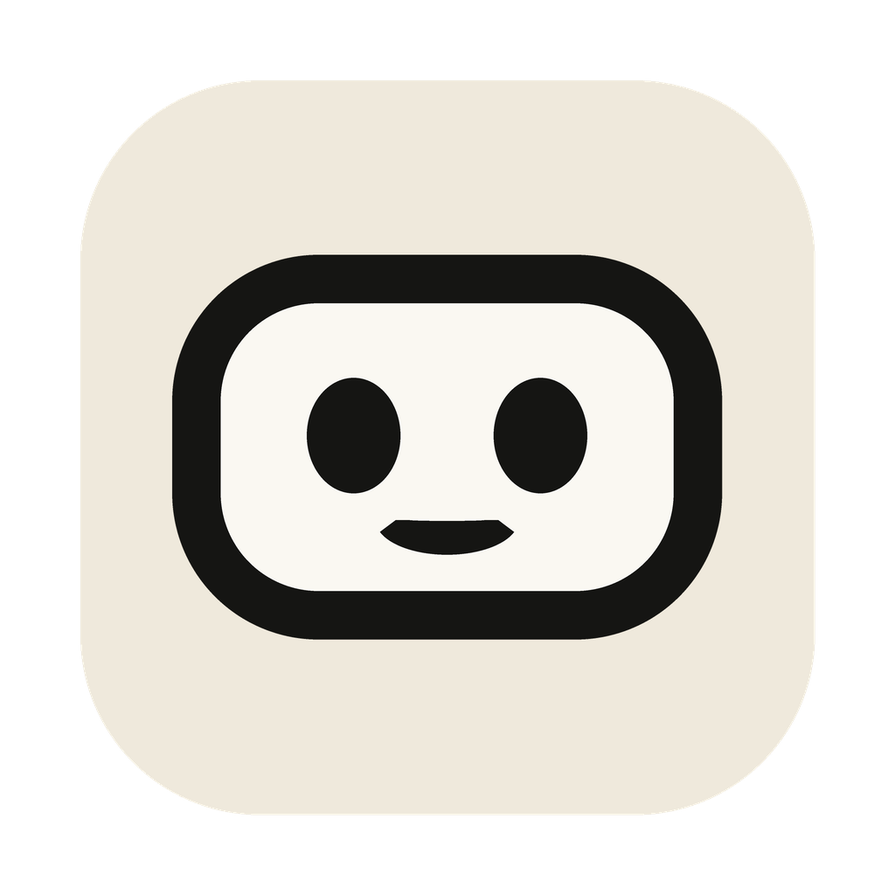

<div align="center">



# Акко

**Маленький чернильный человечек, который живёт у тебя на экране.**<br>
Бегает, прыгает, лезет на окна, летает на джетпаке, засыпает — и ни капли не мешает работать.

<sub>A tiny ink-drawn buddy that runs, climbs and plays on your desktop.</sub>

<br>


[Возможности](#-возможности) · [Установка](#-установка) · [Настройки](#%EF%B8%8F-настройки) · [Производительность](#-производительность) · [Библиотека](#-библиотека-akko) · [Устройство](#-как-устроено)

</div>

---

## ✨ Возможности

<table>
<tr>
<td width="50%" valign="top">

### 🏃 Живёт на рабочем столе
- Ходит по низу экрана и запрыгивает на **Dock**
- Залезает на **окна** — по стенке, прыжком или на джетпаке
- Тащишь окно — **едет на нём**, закрываешь — сваливается
- Прячется за окнами и выглядывает
- Лазит по **иконкам** рабочего стола

</td>
<td width="50%" valign="top">

### 🎭 Больше 50 трюков
- Джетпак 🚀, шарик 🎈, сальто, колесо, лунная походка
- Мячик ⚽, жонглирование, кунг-фу 🥋, брейк-данс
- Фокус с кроликом 🎩, селфи 📸, гитара 🎸, рыбалка 🎣
- Снеговик ⛄ / цветок 🌷 / тыква 🎃 — по сезону
- «Ломается» понарошку: *ОШИБКА 404: Акко не найден* 👾

</td>
</tr>
<tr>
<td valign="top">

### 👀 Замечает, что происходит
- Переключился на WhatsApp — *«кому пишешь? 👀»*
- Играет музыка — танцует с нотками
- Пришло уведомление — бежит под него
- Скриншот — позирует, зарядка — радуется
- Отошёл от компьютера — засыпает

</td>
<td valign="top">

### 💛 Свой характер
- **Энергия**: трюки её тратят, сон и кофе ☕ возвращают
- **Настроение**: растёт от внимания и печенек 🍪
- Скучает, если его долго не замечать, — зовёт поиграть
- Напоминает размяться раз в ~50 минут
- Ночью зевает и смотрит на звёзды

</td>
</tr>
</table>

Его можно **ткнуть, погладить, схватить мышкой и бросить**. Все клики проходят сквозь него к твоим окнам — ловятся, только когда курсор прямо над Акко.

---

## 📦 Установка

### macOS — нативное приложение

```bash
cd mac && ./build.sh --run
```

Соберёт `mac/build/Akko.app` и `Akko-0.1.0.dmg`. Открой `.dmg` и перетащи **Akko** в «Программы».

- Универсальное приложение: Apple Silicon + Intel, macOS 13+
- Нужны только **Xcode Command Line Tools** и **Node.js**
- Настройки: запусти Akko ещё раз (из Launchpad или Spotlight) или значок в строке меню → «Настройки…»
- Показать / спрятать: <kbd>⌘</kbd> <kbd>⌥</kbd> <kbd>⇧</kbd> <kbd>M</kbd>

<details>
<summary><b>Разрешения (необязательны)</b></summary>
<br>

- **Запись экрана** — Акко сам находит края окон, длину дока и иконки, видит поля ввода и меню, на которые можно встать. Он смотрит только на прозрачность пикселей, картинки нигде не сохраняются.
- **Универсальный доступ** — чтобы лазить по папкам и иконкам рабочего стола.

Без разрешений он тоже работает: окна видны и так, а замеры запоминаются для каждой программы.
Если в связке ключей есть сертификат разработчика, `build.sh` подписывает им сборку, и macOS не сбрасывает разрешения после каждой пересборки.

</details>

### Windows — Electron

```bash
cd desktop
npm install
npm start            # запуск из исходников
npm run dist:win     # установщик → desktop/dist/
```

> [!NOTE]
> Сборки не подписаны: в Windows SmartScreen нажми «Подробнее» → «Выполнить в любом случае».

---

## ⚙️ Настройки

| Вкладка | Что внутри |
|---|---|
| **Акко** | размер (S / M / L / XL), язык фраз (English / Русский), экономия энергии, когда прятаться |
| **Характер** | активность, болтливость, бегать за курсором, перерывы, сон ночью, настроение и кнопки ☕ 🍪 |
| **Мир** | лазить по окнам и доку, реагировать на программы, доступ к записи экрана |
| **Система** | запуск при входе, значок в строке меню |

**Когда он прячется сам**

| Переключатель | Что делает |
|---|---|
| Прятаться при видео и звонках | плеер, браузер с видео или звонок просит систему не гасить экран, и Акко уходит |
| Прятаться в полноэкранных играх и презентациях | игра, Keynote / PowerPoint или видеоплеер на весь экран |
| Прятаться при записи и показе экрана | **выключено** — во время записи (<kbd>⌘</kbd><kbd>⇧</kbd><kbd>5</kbd>, QuickTime, OBS) и демонстрации в Zoom Акко остаётся на экране, удобно для демо; **включено** — прячется от записи |

Обычные приложения на весь экран (мессенджер, редактор, браузер) — не повод прятаться: он остаётся рядом.

---

## ⚡ Производительность

MacBook Pro M3 Pro, проценты от одного ядра (приложение + процессы WebKit):

| Режим | Процессор | Память |
|---|:-:|:-:|
| пауза / спрятан | ~0% | ~42 МБ |
| стоит, дышит, моргает | ~2.5% | ~45 МБ |
| ходит / бегает | ~5% | ~52 МБ |
| обычная жизнь, все трюки подряд | ~7% (≈0.6% всего процессора) | ~52 МБ |
| то же, экономия энергии (30 кадров) | ~4% | ~50 МБ |

<details>
<summary><b>Как это достигнуто</b></summary>
<br>

- Всё, что двигается, — анимации, которые играет видеокарта, а не скрипт
- Каждая рука, нога, глаз и аксессуар — отдельный слой; цикл ходьбы рассчитан заранее
- «Кипящие» чернила — три готовые копии рисунка, которые сменяют друг друга
- Эффекты (пыль, вспышки, мячик, реплики) создаются один раз и потом только показываются и прячутся
- На экранах 120 Гц — не чаще 60 кадров (30 при экономии)
- Во сне, при блокировке и на паузе всё полностью стоит
- Курсор не опрашивается постоянно: приложение спит, пока мышь не сдвинется

</details>

---

## 🧩 Библиотека `akko`

Тот же Акко — для любого сайта или веб-приложения. Без зависимостей.

```js
import { createAkko } from "akko";

const akko = createAkko();   // и всё — он уже бегает внизу страницы
```

<details>
<summary><b>Без сборщика, React и все опции</b></summary>
<br>

Одним тегом:

```html
<script src="akko.global.js"></script>
<script>const akko = Akko.createAkko();</script>
```

React:

```jsx
import { Akko } from "akko/react";

<Akko size={48} paused={false} onReady={(c) => (window.akko = c)} />
```

Опции:

```js
createAkko({
  size: 44,                                   // ширина в px
  colors: { bg: "#faf8f2", ink: "#151513", accent: "#c2603f" },
  targets: "[data-chelik], main h1, main h2", // на что можно запрыгивать ("" — ни на что)
  page: document.querySelector("main"),       // что трясти при топоте (null — ничего)
  avoid: ".chat-button",                      // не заходить за этот виджет
  themeToggle: ".theme-switch",               // переключатель темы, который он может «нажать»
  ink: true,                                  // дрожащие чернила: true | "lines" | "filter" | false
  lowPower: false,                            // экономия: без чернил, 30 fps
  fps: 60,
  greet: true,                                // помахать при появлении
  autoStart: true,
  trackPointer: true,                         // false — передавай курсор сам через pointer(x, y)
  respectReducedMotion: true,                 // стоит на месте при «уменьшить движение»
  onAct: (name) => {},
  onInteractive: (on) => {},
  onPerch: (on) => {},
});
```

Пометь элемент атрибутом `data-chelik` — Акко будет на нём сидеть, прыгать и лепить наклейки.
`data-chelik-stomp` — он нажмёт на элемент, когда топнет по нему.

Управление:

```js
akko.pause();  akko.resume();  akko.toggle();
akko.hide();   akko.show();
akko.play("jetpack");                 // трюк прямо сейчас; akko.play() — список всех
akko.set({ size: 60, lowPower: true });
akko.world([[id, 0, x, y, w, h], …]); // окна (0), иконки (1), док (2) для настольных приложений
akko.destroy();
```

Разработка:

```bash
cd core && npm install && npm run build   # → core/dist
python3 -m http.server -d core 5178       # демо: http://localhost:5178/demo.html
```

</details>

---

## 🛠 Как устроено

```
core/       библиотека akko — TypeScript, без зависимостей
  src/engine.ts     поведение: трюки, ходьба, прыжки, бросок, характер
  src/art.ts        рисунок: каждая часть — отдельный слой со своим SVG
  src/chelik.css    позы и анимации
  src/react.ts      обёртка <Akko />
mac/        приложение macOS — Swift + системный WebKit
  Sources/main.swift            оверлей, строка меню, хоткей, сон и батарея
  Sources/SettingsWindow.swift  окно настроек (SwiftUI)
  Sources/World.swift           окна, Dock и иконки → в страницу
  Sources/AutoHide.swift        когда прятаться: видео, полный экран, запись
  build.sh                      сборка .app (arm64 + x86_64) и .dmg
desktop/    приложение Windows — Electron
scripts/    иконки и синхронизация библиотеки
HopBot.*    исходный React-компонент, с которого всё началось
```

Подробные заметки для разработки — в [ИНСТРУКЦИЯ.md](ИНСТРУКЦИЯ.md).

---

<div align="center">

Сделано с ☕ — [@yahyagazizuly](https://github.com/yahyagazizuly) · [MIT](LICENSE)

</div>
